   

## 👋 Hi, I'm Duc Anh

A motivated fresh graduate passionate about software development,
actively building my skills and seeking an internship opportunity
to grow in a real-world environment.

---

## 🙋 About Me

- 🎓 Fresh graduate, self-learning and transitioning into Software Development
- 💻 Currently strengthening my foundations in **Web Development**
- 🌱 Hands-on practice with: **HTML, CSS, JavaScript, PHP, Java**
- 🛠️ Enjoy building small projects to apply what I learn every day
- 🤝 A fast learner who values teamwork, feedback, and continuous improvement
- 📬 Actively looking for **Internship / Fresher Developer** opportunities

 

<table>
  <tr>
    <td align="center" width="50%">
      <strong>📋 My Resume</strong>  
      
    </td>
    <td align="center" width="50%">
      <strong>📫 Let's Connect</strong>  
      
    </td>
  </tr>
</table>

---

## 🌐 Socials

---

## 💻 Tech Stack Basic [📝](#)

---

## 🏆 GitHub Trophies

---

## ✍️ Random Dev Quote

---

## 📈 User Statistics

<table>
  <tbody>
    <tr>
      <td>
        
      </td>
    </tr>
  </tbody>
</table>

<table>
  <tbody>
    <tr>
      <td>
        
      </td>
    </tr>
  </tbody>
</table>

<table>
  <tbody>
    <tr>
      <th>
        
      </th>
      <th>
        
      </th>
    </tr>
  </tbody>
  <tbody>
    <tr>
      <td>
        
      </td>
      <td>
        
      </td>
    </tr>
  </tbody>
</table>

## 👾 Pac-Man Contribution Graph
<picture data-importer="pacman">
  <source media="(prefers-color-scheme: dark)" srcset="https://raw.githubusercontent.com/ducanhphamorg/ducanhphamorg/pacman-output/pacman-contribution-graph-dark.svg?game=pacman">
  <source media="(prefers-color-scheme: light)" srcset="https://raw.githubusercontent.com/ducanhphamorg/ducanhphamorg/pacman-output/pacman-contribution-graph.svg?game=pacman">
  
</picture>
